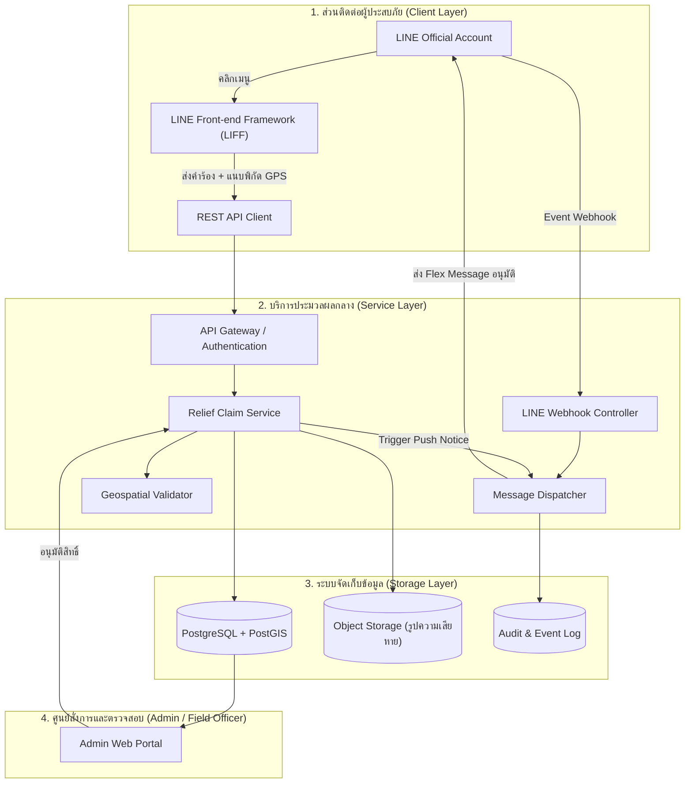

# แผนผังระบบช่วยเหลือเยียวยาผู้ประสบอุทกภัย (Flood Relief & Remedy System - LINE Integration)

## 1. ขอบเขตสถาปัตยกรรมระบบ (System Architecture Scope)

ระบบประกอบด้วย 3 เลเยอร์หลัก:
1. **Citizen Touchpoint (LINE OA & LIFF)**: ช่องทางผู้ประสบภัยใช้งานผ่าน LINE App
2. **Backend Processing Service**: API Gateway, Webhook Router, Geospatial Query, และ Background Task สำหรับกระจายการแจ้งเตือน
3. **Admin & Field Officer Dashboard**: ระบบตรวจสอบคำร้อง อนุมัติการจ่ายเงิน และแผนที่แสดงจุดเกิดภัยพิบัติ

## 2. ขั้นตอนการตั้งค่าฝั่ง LINE Developers Console (Setup Prerequisites)

| ลำดับ | รายการ | ขั้นตอนดำเนินการ |
| :--- | :--- | :--- |
| **1** | LINE Official Account | สร้างบัญชีทางการที่ [manager.line.biz](https://manager.line.biz) กำหนดชื่อ เช่น "ศูนย์เยียวยาน้ำท่วม" |
| **2** | LINE Developers Console | เข้าสู่ [developers.line.biz](https://developers.line.biz) สร้าง Provider สำหรับองค์กร |
| **3** | Messaging API Channel | สร้าง Channel ประเภท **Messaging API** เพื่อรับ Channel Access Token และ Channel Secret |
| **4** | Webhook URL | กำหนด Webhook URL ชี้ไปยัง Endpoint ของระบบ เช่น `https://api.yourdomain.gov.th/api/v1/line/webhook` |
| **5** | LINE Login & LIFF App | สร้าง Channel ประเภท **LINE Login** เพิ่ม LIFF App (ขนาด Full View) สำหรับหน้าลงทะเบียน |
| **6** | Rich Menu Config | ออกแบบ Rich Menu และผูก Action เปิด LIFF URL และส่งข้อความตรวจสอบสถานะ |

## 3. ผังข้อมูลคำร้อง (Relief Claim Data Schema)

- `claim_id`: รหัสคำร้องอ้างอิง (เช่น FL-2026-XXXX)
- `line_user_id`: รหัสประจำตัว LINE ของผู้ยื่น
- `citizen_national_id`: รหัสประจำตัวประชาชน 13 หลัก
- `claimant_full_name`: ชื่อ-นามสกุล
- `phone_number`: เบอร์โทรศัพท์ติดต่อ
- `flood_latitude` / `flood_longitude`: พิกัดพิกัดทางภูมิศาสตร์
- `house_address`: ที่อยู่ตามทะเบียนราษฎร์และที่อยู่จุดประสบภัย
- `disaster_type`: ประเภทความเสียหาย (น้ำท่วมขังเกิน 7 วัน, ทรัพย์สินเสียหายสิ้นเชิง)
- `evidence_photo_urls`: รายการ URL รูปภาพความเสียหาย
- `verification_status`: `PENDING_REVIEW` | `FIELD_VERIFIED` | `APPROVED` | `REJECTED` | `PAID`
- `disbursed_amount`: ยอดเงินเยียวยาที่ได้รับอนุมัติ
